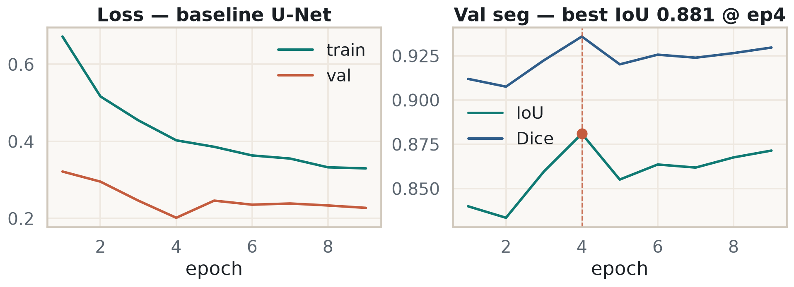
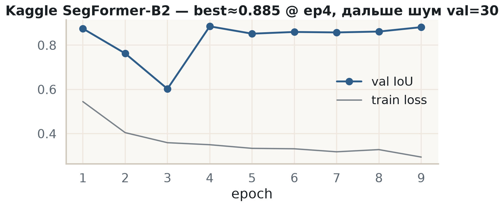
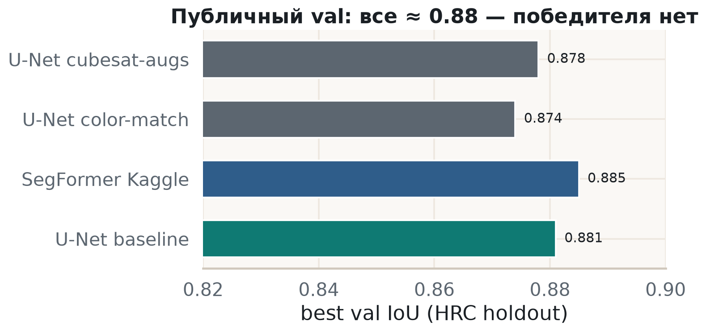
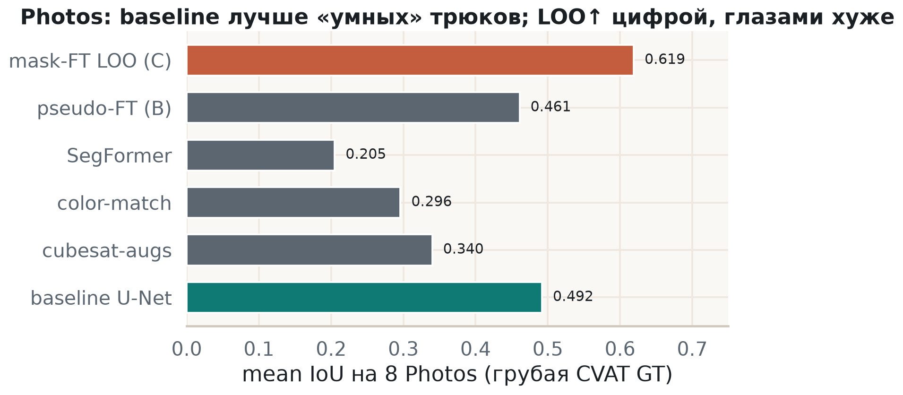
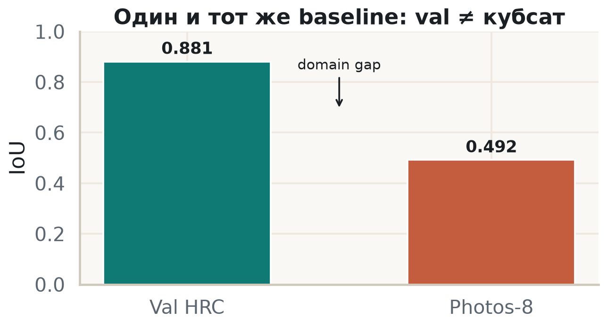
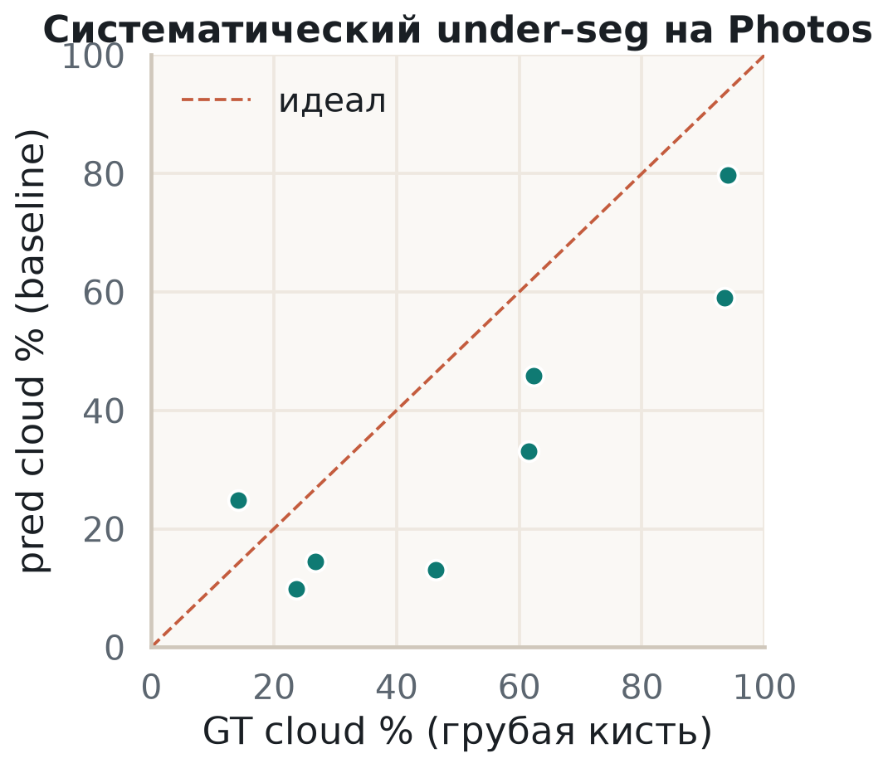

# Облачность на снимках кубсатов (СПУТНИКС)

**Победитель кейса:** U-Net ResNet34 ImageNet, обученный на weighted mix HRC + SPARCS + 38-Cloud (best checkpoint эпохи 4).

Все цифры ниже — из уже проведённых EDA и прогонов. Ничего не откладывается «в другой документ»: если факт нужен на слайде, он написан здесь.

---

# 1. Задача

## 1.1. Что за кейс

Кейс СПУТНИКС: по кадрам обзорных камер кубсатов (**Photos**, RGB JPEG) нужно оценить **долю облачности на кадре** и принять решение **reject**, если облачность выше **75%**.

На практике это значит:

- оператор или пайплайн получает кадр «с орбиты»;
- система отвечает: «примерно столько процентов кадра закрыто облаками»;
- если процент выше 75 — кадр **не берём** в дальнейшую обработку / не считаем полезным для целевого наблюдения.

Вход — не «космический Landsat с NIR», а **обычные RGB JPG** с кубсатов, с разрешением порядка **~200 м на пиксель**, с KML-метаданными (центр, борт, время). Готовой пиксельной разметки облаков у Photos **сначала не было**.

## 1.2. Почему это сводится к сегментации маски облаков

Процент облачности на кадре — это не отдельная «магическая регрессия с нуля». Самый прямой и проверяемый путь:

1. получить **бинарную (или soft) маску облаков** по пикселям;
2. посчитать **долю пикселей маски** → `% облачности`;
3. сравнить с порогом **75%** → keep / reject.

Именно поэтому в литературе и в нашем пайплайне задача живёт как **сегментация облаков** (cloud mask), а не как классификация «облачно / ясно» на весь кадр. Классификация кадра теряет границы и плохо калибруется под порог 75%. Сегментация даёт и визуальный контроль, и процент, и reject из одной головы модели.

## 1.3. Почему сегментация облаков — уже зрелая тема в remote sensing

Задача детекции / сегментации облаков на оптических снимках — стандартный трек в Earth observation. Ниже — сжатый обзор поля с цифрами из статей и лидерборда cloudseg (это **чужие** бенчмарки, не наши прогоны на Photos).

**Классика 2019–2021:** Cloud-Net / Cloud-Net+ на бенчмарке **38-Cloud** (часто RGB+NIR Landsat). На архиве 38-Cloud Semantic Segmentation Cloud-Net+ держит Jaccard **~88.90**, Cloud-Net **~87.32**.

**Дальше:** attention / dual-branch / high-res сети; **SegFormer** как практичный transformer-baseline (на Sentinel Cloud Mask Catalogue в сравнении 2025 SegFormer IoU **0.85** > U-Net / DeepLab).

**2025:** **Cloud-Adapter** (frozen VFM + лёгкий adapter) лидирует на живом мультисенсорном лидерборде cloudseg.

**2026:** CloudMamba, STUPmask, DinoCloudNet и др. — свежий SOTA-нарратив, но часто MSI / другой стек / другой GSD.

**Таблица cloudseg (mIoU %, ↑)** — снимок с GitHub Cloud-Adapter / страницы проекта:

| Method | HRC | GF1 | GF2 | L1C | L2A | L8B |
|--------|----:|----:|----:|----:|----:|----:|
| CDNetv2 | 76.75 | 84.93 | 78.84 | 65.60 | 66.05 | 43.63 |
| UNetMobv2 | 79.91 | 91.71 | 80.44 | 71.65 | 70.36 | 47.76 |
| DBNet | 77.78 | 91.36 | 78.68 | 65.52 | 65.65 | **51.41** |
| HRCloudNet | 83.44 | 91.86 | 75.57 | 68.26 | 68.35 | 43.51 |
| KappaMask | 67.48 | 92.42 | 72.00 | 41.27 | 45.28 | 42.12 |
| **Cloud-Adapter** | **89.05** | **92.55** | **83.02** | **74.18** | **73.38** | **57.53** |

**CloudMamba vs baselines** (Table I статьи, GF1_WHU / Levir_CS):

| Method | GF1_WHU mIoU | Levir_CS mIoU |
|--------|-------------:|--------------:|
| U-Net | 84.72 | 89.43 |
| DeepLabV3+ | 86.66 | 81.10 |
| U-Mamba | 86.94 | 90.78 |
| **CloudMamba** | **89.27** | **91.24** |

**Вывод по литературе для нашего кейса:** на 38-Cloud «висит» Cloud-Net+, потому что новые работы редко пересдают этот протокол. На современных мультисенсорных сетах лидируют **Cloud-Adapter** и соседние VFM/adapter / high-res сети. Но успех на 38-Cloud Jaccard / HRC mIoU ≠ готовность к Photos. Критерий сдачи — **% и reject@75 на кубсатах**, а публичные сеты — мост (pretrain + ablations).

---

# 2. Изучили данный датасет (Photos)

## 2.1. Что за данные

| Поле | Факт из EDA / каталога |
|------|------------------------|
| Сырые кадры | RGB JPG обзорных камер кубсатов (сырой архив Photos; в git не кладём) |
| Разметка / выборка | 40 labeling-превью, сид выборки 42; позже **8** кадров с CVAT-масками толстой кистью |
| Тип | RGB JPG |
| GSD | порядка **~200 м/пкс** |
| Объём | **4270** кадров с валидным KML в EDA photos; в сводке датасетов также фигурирует **4272** JPG; диск Photos ~**33.3 GB** |
| Борта | **38** уникальных |
| Даты (EDA photos) | **2024-10-30 03:34:02 → 2026-11-14 08:00:17** |
| География | глобальная: широта **−80.9…82.8**, долгота **−179.7…179.0** |
| Широтные корзины (4270) | tropics **1843** · mid **1842** · polar **585** |
| Цветовая подвыборка EDA | **400** кадров (сид 42); deep EDA cloud/color — **240** Photos |
| Метаданные | KML / каталог с центрами; labeling-превью **768×577**, полные JPG порядка ~3280×2464 |

Примеры сырых кадров и labeling-превью:


Карта центров и сезон/борта:


## 2.2. Проблемы домена (честно)

1. **Нет готовых пиксельных масок** на старте. Без GT нельзя честно учить «под Photos» и нельзя калибровать порог 75% на целевом сенсоре.
2. **Domain gap** к публичным сетам: Landsat/Sentinel ~10–30 м, другая оптика, другая калибровка цвета, часто есть NIR/MSI — у Photos только RGB JPEG.
3. **Цвет и контраст:** у Photos сильный сдвиг по каналам (особенно синий / hue) относительно Landsat-патчей — это видно в deep EDA (ниже).
4. **Разрешение ~200 м:** мелкие облака и тонкие края выглядят иначе, чем на HRC (0.5–15 м) или Landsat 30 м.
5. **Снег / haze / пустыня / блики:** прокси «белизны» путает их с облаками. В labeling-выборке из 40 кадров это прямо предупреждено: `white_frac_proxy` — для стратификации, не GT.
6. **Разметка, которая появилась позже:** 8 кадров с CVAT-масками сделаны **толстой кистью** — ориентир для глаз и грубых IoU, не «золотой стандарт границ».

## 2.3. Что дало EDA

Цифры ниже — из deep EDA (подвыборки seed 42): cloud fraction, channel stats, distance to Photos, статистические тесты Photos vs публичные; плюс полные сводки SPARCS / 38-Cloud / stage-1.

### Облачность / прокси

На подвыборках deep EDA (seed 42):

| Датасет | n | mean cloud/proxy | median | near-empty | near-full | p25 | p75 |
|---------|--:|-----------------:|-------:|-----------:|----------:|----:|----:|
| Photos (white_frac proxy) | 240 | **0.051** | 0.032 | **0.617** | 0.000 | 0.010 | 0.070 |
| 38-Cloud | 397 | **0.485** | 0.425 | 0.249 | **0.285** | 0.051 | 0.987 |
| SPARCS | 80 | **0.194** | 0.139 | 0.263 | 0.000 | 0.045 | 0.249 |
| HRC_WHU | 150 | **0.342** | 0.320 | 0.007 | 0.000 | 0.187 | 0.458 |
| GF1 pack | 400 | **0.101** | 0.002 | **0.663** | 0.010 | 0.000 | 0.111 |
| S2 catalogue | 513 | **0.526** | 0.558 | 0.326 | **0.398** | 0.001 | 1.000 |

SPARCS: mean cloud **19.4%**, snow **5.3%**, сцен >75% — **2/80**. На 38-Cloud EDA-подвыборке n=800: mean cloud **49.6%**, доля >75% ≈ **36.8%**.

Photos по прокси гораздо «яснее», чем 38-Cloud/S2: **~62%** кадров near-empty по white_frac, а у 38-Cloud **~28%** near-full. Если кормить микс «плотных» Landsat-облаков без весов, модель выучит prior плотных масок и будет плохо попадать в типичный Photos-кадр.


### Цвет RGB

Средние каналы (deep EDA):

| Датасет | n | mean R | mean G | mean B | hue_mean | L2 до Photos |
|---------|--:|-------:|-------:|-------:|---------:|-------------:|
| Photos | 240 | 0.418 | 0.518 | **0.708** | **0.613** | 0 |
| HRC_WHU | 150 | 0.491 | 0.494 | 0.473 | 0.314 | **0.248** |
| S2 | 180 | 0.429 | 0.429 | 0.425 | 0.392 | 0.297 |
| 38-Cloud | 180 | 0.374 | 0.374 | 0.369 | 0.329 | 0.371 |
| GF1 | 180 | 0.213 | 0.391 | 0.390 | 0.481 | 0.399 |
| SPARCS | 80 | 0.243 | 0.287 | 0.209 | 0.256 | 0.577 |

Photos заметно «синее» (B≈0.71) и с другим hue (~0.61 vs ~0.25–0.39 у публичных). HRC ближе по L2 средних RGB, чем SPARCS (хотя SPARCS ценен качеством масок и классами shadow/snow). Ранний compare Photos vs 38-Cloud на других подвыборках (400 vs 800) давал L2≈**0.385** — порядок тот же.


Стат. тесты Photos vs публичные (Kolmogorov–Smirnov / Mann–Whitney) по каналам и cloud_frac дают очень маленькие p-value — распределения **не совпадают**. Это не «шум выборки», а системный сдвиг домена.

### Слабый эвристический baseline (stage-1)

На 300 патчах 38-Cloud (seed 42): яркость + низкая насыщенность → MAE по % облачности ≈ **42%**, accuracy keep/delete@75 ≈ **0.68**. Это честный пол: нейросеть должна быть заметно лучше на публичном holdout; на Photos эвристика ещё опаснее из‑за снега/haze.

## 2.4. Выводы EDA → что делать дальше

1. Нужен **transfer / pretrain** на публичных RGB-масках — учить с нуля на Photos нельзя (нет GT).
2. Нужен **weighted mix**, а не «склеить всё поровну»: HRC↑ (ближе по цвету + хорошие маски), SPARCS↑ (качество + fail-modes), 38-Cloud↓ (объём, но mediocre masks + другой prior облачности).
3. Нужна **калибровка / finetune на Photos** после появления хотя бы небольшой аккуратной разметки; color-match и пороги без GT — слабые рычаги (это подтвердилось экспериментами ниже).
4. Метрики успеха продукта: **MAE по %** и **reject@75 на Photos**; IoU на HRC — вспомогательный сигнал сходимости, не финал кейса.

---

# 3. Какие датасеты существуют для задачи

Ниже — «зоопарк» публичных и целевых наборов для сегментации облаков. Для каждого: что это, размеры, и **почему взяли / не взяли**.

Сводная таблица решения:

| Датасет | На диске | Маски | Disk (ориентир) | Решение |
|---------|----------|-------|-----------------|---------|
| Photos | да | нет pixel GT (8 CVAT позже) | ~33.3 GB | **целевой** продукт |
| HRC_WHU | да | хорошие | ~110 MB | **в train**, вес ↑ |
| SPARCS | да | хорошие | ~1.45 GB | **в train**, вес ↑ |
| 38-Cloud | да | mediocre | ~8.6 GB | **в train**, вес ↓ |
| GF1 pack | да | mediocre | ~0.9 GB | EDA / опция; **не** в победившем миксе |
| S2 Catalogue | да | хорошие (эксперт) | masks + ~15 GB subscenes | EDA / опция; **не** в победившем миксе |
| 95-Cloud | нет | — | ещё кусок семейства 38 | **не брали** (низкий ROI) |
| CloudSEN12 full / Levir | нет | — | 100–250 GB / 34 GB+ | **не брали** |
| L8 Biome / GF2 HF | нет (опц.) | — | ~1.7–2.6 GB zip | «потом», не блокер |

## 3.1. 38-Cloud

| Поле | Значение |
|------|----------|
| Сенсор / размер | Landsat-8, патчи **384²**, классический бенчмарк Cloud-Net |
| Каналы у нас | **RGB без NIR** (~8.6 GB на диске) |
| Train GT | **~8400** labeled патчей |
| Cloud frac (deep n=397) | mean **0.485**, median 0.425; near-full **~28%** |
| EDA n=800 | mean **49.6%**, доля >75% ≈ **36.8%** |
| Качество масок | **посредственное** — грубые границы, артефакты краёв сцен |
| GSD | ~30 м |

**Почему взяли:** большой labeled RGB-объём, ручные маски (не QA60), удобный размер под 4060/T4, цитируемый бенчмарк.  
**Почему не «учитель истины»:** mediocre masks, другой prior облачности vs Photos, domain gap по GSD/оптике.

## 3.2. SPARCS

| Поле | Значение |
|------|----------|
| Источник | USGS validation |
| Сцены | **80** × ~**1000²**, multi-class cloud/shadow/snow/water/land |
| Диск | ~**1.45 GB** |
| Cloud / snow | cloud mean **19.4%**, snow **5.3%**, >75% — **2/80** |
| Качество масок | **хорошее** (валидационный сет) |
| L2 RGB → Photos | **0.577** (самый далёкий среди скачанных) |

**Взяли:** хорошие маски + fail-modes (shadow/snow) важнее «красивого среднего RGB». На нём в литературе валидируют Cloud-Net+, TransCNet, CLiSA.  
**Не равен Photos по цвету** — это осознанный trade-off.

## 3.3. HRC_WHU

| Поле | Значение |
|------|----------|
| Формат | RGB **1280×720**, mmseg-раскладка train/test |
| Объём | **150** сцен: train **120** / test **30** |
| GSD | **0.5–15 м**; 5 типов поверхности (water/veg/urban/snow/barren) |
| Диск | ~**110 MB** (HF zip Cloud-Adapter) |
| Cloud frac | mean ≈ **0.34** |
| Качество масок | **хорошее** |
| L2 RGB → Photos | **0.248** (лучший среди скачанных) |

**Взяли обязательно:** RGB, хорошие маски, ближе к Photos по цвету, якорь **val = HRC test**. На нём меряют Cloud-Adapter / NFCNet / HRCloudNet.

## 3.4. GF1 (pack Cloud-Adapter `gf12ms_whu_gf1`)

| Поле | Значение |
|------|----------|
| Пары | **10428** PNG ~256² |
| Диск | ~**0.9 GB** |
| Cloud frac | mean ≈ **0.10**, median ≈ **0.002** (много clear; near-empty **~66%**) |
| Качество масок | **посредственное** (уровень близко к 38-Cloud) |


**На диск взяли** для сравнения / строки «как у Cloud-Adapter». **В финальный train-mix победителя не включали:** mediocre labels, домен не Photos, вес в плане был бы **0.3**.

## 3.5. Sentinel-2 Cloud Mask Catalogue (Francis)

| Поле | Значение |
|------|----------|
| Кадры | **513** subscenes **1022²** @ 20 m; Zenodo 4172871 |
| Маски | CLEAR / CLOUD / SHADOW (bool HxWx3), экспертные |
| RGB для EDA | B4,B3,B2 (percentile 2–98) |
| Диск | thumbs ~146 MB; masks+subscenes тяжёлые (~**15.2 GB** subscenes) |
| Cloud frac | mean ≈ **0.53**, много крайних 0/1 |


**Скачали / разобрали** как другой сенсор с хорошими масками (на нём сравнивали SegFormer vs U-Net). **В train победителя не входили** — mid-weight опция на будущее.

## 3.6. 95-Cloud

Расширение семейства 38-Cloud (+ ещё ~57 сцен train того же Landsat RGBNir мира). На Wizwand SOTA Jaccard часто ~**91.57** (линия Cloud-Net+).

**Не брали сейчас:** мало новой информации при том же Landsat-домене; ROI низкий, пока не закрыт Photos GT. NFCNet учился в т.ч. на 95-Cloud RGB — для нас это related work, не обязательный архив.

## 3.7. L8 Biome / CloudSEN12 (full)

| Сет | Ориентир размера | Почему не брали полный объём |
|-----|------------------|------------------------------|
| L8 Biome (HF zip) | ~**2.6 GB** | multi-class Landsat; можно позже под Cloud-Adapter-строку |
| CloudSEN12-high L1C/L2A (HF) | ~**3.1 + 3.4 GB** | MSI Sentinel, не RGB Photos |
| CloudSEN12 full | ~**100–250 GB** / legacy ~TB | диск и время учебного кейса |

**Не брали полный объём.** Цель кейса — Photos, не таблица mIoU как у статьи.

## 3.8. Levir_CS / полные GF1_WHU сцены CloudMamba

Levir_CS ~**34 GB** 7z (full-res ещё больше); полные GF1_WHU сцены — тяжёлые Drive/Baidu архивы под цифры CloudMamba.

**Не брали:** нет места/времени под дедлайн; часто не RGB-only story под кубсат.

## 3.9. Cloud-Adapter HF packs (GF2, CloudSEN12-high, …)

Удобные zip с Hugging Face (репо XavierJiezou/cloud-adapter-datasets, суммарно ~12.5 GB).

**Частично:** HRC и GF1 скачаны; GF2 (~1.7 GB), CloudSEN12-high, L8 Biome — по приоритету места после сдачи.

---

# 4. Какие взяли — подробнее

**Фактический train победителя:** HRC + SPARCS + 38-Cloud.  
GF1 и S2 — на диске и в EDA, но **не** в этом миксе.

Веса сэмплирования по умолчанию:

| Источник | Вес | Зачем |
|----------|----:|-------|
| HRC | **3.0** | ближе по цвету + хорошие маски |
| SPARCS | **2.5** | качество + shadow/snow |
| 38-Cloud | **1.0** | объём, но mediocre + другой prior |
| S2 (если включить) | 1.5 | mid |
| GF1 (если включить) | 0.3 | низкий |
| Photos | 0.0 | только после нормальных масок |

Сэмплирование **по весам**, не «пропорционально длине датасета» — иначе 38-Cloud с тысячами патчей забьёт HRC/SPARCS.

## 4.1. HRC_WHU

- 150 RGB сцен, train 120 / test 30 — **val кейса = HRC holdout**
- cloud frac mean ≈ 0.34
- качество масок: **хорошее**


**Вывод:** якорь микса. Именно поэтому вес 3.0 и именно HRC test — основной val IoU при обучении.

## 4.2. SPARCS

- 80 сцен, RGB + multi-class маски → cloud binary для train
- cloud frac mean ≈ 0.25; snow ≈ 5%
- качество масок: **хорошее** (validation set)


**Вывод:** поднимаем вес (2.5), несмотря на далёкий средний RGB — учим не «цвет ради цвета», а границы/тени/снег на честных масках.

## 4.3. 38-Cloud

- ~8400 train GT (RGB), патчи 384²
- cloud frac mean ≈ 0.50 на nonempty; доля >75% высока
- качество масок: **посредственное** (грубые границы, артефакты краёв)


**Вывод:** нужен как «мясо» градиентов, но вес 1.0 (и в абляциях ещё ниже), иначе модель залипает на Landsat-плотных облаках.

## 4.4. Почему неравные веса (связь с domain proximity)

1. **Качество масок** важнее сырого объёма: HRC/SPARCS > 38-Cloud/GF1.
2. **Цветовая близость к Photos:** HRC лучше 38-Cloud/SPARCS по L2 средних RGB → HRC↑.
3. **Распределение облачности:** 38-Cloud/S2 слишком «облачные» vs Photos proxy → их долю в эпохе режем.
4. **Практика абляций:** прогон с HRC↑↑ и cubesat-augs (веса HRC 5.0 / SPARCS 2.5 / 38-Cloud 0.15) дал val IoU ~0.878, но на Photos IoU упал до ~0.34 — «крутить микс под val HRC» ≠ чинить кубсат.

---

# 5. Модели

## 5.1. Зоопарк (плюсы / минусы для нашего кейса)

Цифры в колонке «лит. ориентир» — из статей / cloudseg, **не** наши прогоны на Photos.

| Модель | Плюсы | Лит. ориентир (чужой бенчмарк) | Минусы для Photos / нашего железа |
|--------|-------|--------------------------------|-----------------------------------|
| **Cloud-Net / +** | Исторический стандарт 38-Cloud; идея FJL / soft Jaccard | Jaccard ~**88.9** (Cloud-Net+) / **87.3** (Cloud-Net) на 38-Cloud | Часто RGBNir; заточен под Landsat; не наш сенсор |
| **U-Net ResNet34** | Простой, SMP, ImageNet, влезает в **4060 8 GB**, быстро итерируется | На GF1_WHU в таблице CloudMamba U-Net mIoU **84.72** (чужой протокол) | «Не SOTA-слайд», но воспроизводим и реально обучен у нас |
| **SegFormer-B2** | Современный mid-tier transformer; RGB; удобно на **T4** @512 | IoU **0.85** > U-Net/DeepLab на S2 Catalogue (статья 2025) | На Photos в нашем тесте сильнее under-seg, чем U-Net |
| **Cloud-Adapter** | Живой SOTA 2025 на cloudseg; RGB-friendly идея VFM+adapter | HRC mIoU **89.05**, GF1 **92.55**, L8B **57.53** | Нужен **mmseg + DINOv2**, ≥16 GB; на Kaggle Py3.13 **mim/mmseg ломается** |
| **HRCloudNet / NFCNet** | High-res / RGB-friendly идеи под HRC и 95-Cloud | HRCloudNet HRC mIoU **83.44**; NFCNet бьёт UNet/DeepLab на HRC/CHLandsat/95-Cloud RGB | Нет готового порта под наш train-mix к дедлайну |
| **CloudMamba** | Свежий 2026, тонкие облака / uncertainty | GF1 **89.27**, Levir **91.24** | Другой стек / часто не RGB-only; риск по времени |
| **STUPmask / CLiSA** | Кросс-сенсорный narrative (близко к Photos-story) | STUPmask OA ~**97.5%** L8 / **96.3%** S2 (статья) | Тяжёлый Swin+UPerNet / другой train-протокол |
| **CloudMatch** | Semi-sup при малой разметке — релевантно Photos | weak→strong adaptation | Позже, когда будет нормальный Photos train |
| **TransCNet / DinoCloudNet** | Dual-branch RGB / эволюция adapter-линии | TransCNet vs Cloud-Net/CDNetV2/SegFormer на RGB 352² | Нет лёгкого порта в наш SMP-каркас к дедлайну |

## 5.2. Ограничения выбора

- Локально: **RTX 4060 8 GB**
- Облако: **Kaggle T4 16 GB**
- Вход продукта: **Photos RGB** (~200 м), не Landsat RGBNir и не Sentinel MSI
- Дедлайн учебного кейса
- Стек: PyTorch + SMP; Cloud-Adapter тянет **mmseg**, который на **Kaggle Python 3.13** упирается в поломку `mim` / `pkgutil.ImpImporter` / старый setuptools

Приоритет как план (и что из него получилось):

1. Cloud-Adapter на T4 — **не получили** рабочий train;
2. U-Net baseline на 4060 — **сделали, победитель**;
3. SegFormer-B2 mid-tier — **сделали на T4**;
4. CloudMamba опц. — **не гоняли**;
5. finetune на Photos — пробовали A/B/C, честный прод-путь ещё впереди.

## 5.3. Что реально взяли

1. **Baseline U-Net ResNet34 ImageNet** — основной путь на 4060, победитель кейса.  
2. **SegFormer-B2 на Kaggle T4** — современное сравнение на том же миксе HRC+SPARCS+38 @512.  
3. **Абляции того же U-Net:** color-match meanstd; HRC-heavy + cubesat-augs; thr-калибровка; soft pseudo-FT; mask-FT на 8 CVAT.  
4. **Cloud-Adapter** — пытались вынести на Kaggle как SOTA-ветку; **не взлетело** как рабочий train: не встроен в локальный SMP-каркас (нужен mmseg+DINOv2), а на Kaggle установка через `mim` падает на Py3.13. Для кейса T4 стал путём **SegFormer**, не adapter.

---

# 6. По каждой реально гонявшейся модели — обучение и результаты

Общий принцип метрик:

- **Val** = HRC test holdout (если не сказано иное)
- **Photos-8** = грубые CVAT-маски (толстая кисть); цифры — ориентир, смотреть triplets
- Сид **42**, если не указано иначе

## 6.1. U-Net mix baseline (победитель)

| Параметр | Значение |
|----------|----------|
| Модель | U-Net, encoder ResNet34, ImageNet |
| Данные | HRC + SPARCS + 38-Cloud |
| Веса микса | 3.0 / 2.5 / 1.0 |
| image_size | 384 |
| batch_size | 4 (факт рана; plan 4060 допускает до 8) |
| lr | 3e-4 |
| epochs (план) | 20; early stop по best |
| loss | Dice + BCE (`jaccard_weight=0`) |
| color-match | нет |
| seed | 42 |
| device | CUDA 4060 |

**Лучшая эпоха:** **ep4** — val IoU **0.8809**, Dice **0.9358**, MAE% **2.05**, reject@75 **1.00**.

Полная таблица val по эпохам (ран остановился после ep9; best = ep4):

| epoch | train_loss | val IoU | val Dice | MAE% | reject@75 | epoch_sec | best? |
|------:|-----------:|--------:|---------:|-----:|----------:|----------:|------:|
| 1 | 0.672 | 0.840 | 0.912 | 3.90 | 1.00 | 595 | да |
| 2 | 0.517 | 0.833 | 0.908 | 4.69 | 1.00 | 403 | |
| 3 | 0.455 | 0.860 | 0.922 | 3.34 | 1.00 | 371 | да |
| **4** | **0.403** | **0.881** | **0.936** | **2.05** | **1.00** | 392 | **да** |
| 5 | 0.386 | 0.855 | 0.920 | 3.91 | 1.00 | 440 | |
| 6 | 0.363 | 0.864 | 0.926 | 3.57 | 1.00 | 417 | |
| 7 | 0.355 | 0.862 | 0.924 | 3.28 | 1.00 | 333 | |
| 8 | 0.333 | 0.868 | 0.926 | 3.14 | 1.00 | 319 | |
| 9 | 0.330 | 0.871 | 0.930 | 2.77 | 1.00 | 369 | |




Качество на train/val микса (triplets RGB | GT | pred):


**Вывод:** на публичном HRC holdout модель сильная и стабильная (reject@75 на val всегда 1.0). Это хороший **инженерный baseline**, но ещё не ответ про кубсаты — domain gap на Photos разобран в §6.6.

## 6.2. U-Net + color-match meanstd

Тот же микс, но при train публичные кадры подтягивались к статистикам Photos методом meanstd (`color_match_photos=true`). На инференсе Photos color-match **не** включали.

| Параметр | Как у baseline, плюс |
|----------|----------------------|
| color-match | meanstd к статистикам Photos на публичных кадрах при train |
| Инференс Photos | без color-match |

**Best val:** ep10 — IoU **0.874**, Dice **0.932**, MAE% **2.16**, reject@75 **1.00**.

Ключевые эпохи:

| epoch | val IoU | val Dice | MAE% | reject@75 | best? |
|------:|--------:|---------:|-----:|----------:|------:|
| 1 | 0.764 | 0.861 | 6.35 | 1.00 | да |
| 3 | 0.848 | 0.915 | 4.70 | 1.00 | да |
| 4 | 0.674 | 0.784 | 19.85 | 0.80 | | 
| 8 | 0.866 | 0.927 | 3.05 | 1.00 | да |
| **10** | **0.874** | **0.932** | **2.16** | **1.00** | **да** |
| 15 | 0.871 | 0.930 | 2.99 | 1.00 | |

На Photos-8 (thr=0.5): IoU **0.296**, Dice **0.401**, MAE% **34.7**, reject@75 **0.750** — ещё сильнее under-seg, чем baseline (0.492 / 20.5 / 0.875).

Per-image IoU vs baseline:

| файл | baseline | color-match |
|------|---------:|------------:|
| 01_…2325 | 0.456 | 0.428 |
| 02_…2331 | 0.841 | **0.306** |
| 03_…2342 | 0.400 | 0.560 |
| 04_…2341 | 0.732 | **0.014** |
| 05_…2325 | 0.632 | 0.695 |
| 06_…2360 | 0.281 | **0.050** |
| 08_…2313 | 0.536 | 0.313 |
| 11_…2342 | 0.054 | **0.000** |


**Вывод:** подтягивание цвета публичных кадров к Photos **не** закрыло gap; на целевом домене стало хуже (особенно mid/dense кадры 02/04/06). Val HRC чуть ниже baseline — color-match не берём в прод-нарратив.

## 6.3. SegFormer-B2 (Kaggle T4)

Один Kaggle-ноутбук: ставит код, HRC (HF), SPARCS (OSU zip), symlink на 38-Cloud и запускает train-mix SegFormer-B2 на T4 (Internet ON, GPU T4).

| Параметр | Значение |
|----------|----------|
| Модель | SegFormer-B2 (mit_b2, ImageNet) |
| Данные | HRC + SPARCS + 38-Cloud (тот же микс, что baseline) |
| image_size | **512** (vs 384 у U-Net) |
| batch_size | 4 |
| epochs | 10 (факт: history до ep9) |
| lr | 3e-4 |
| seed | 42 |
| device | Kaggle T4 |

**Best:** ep4 — val IoU **0.885**, Dice **0.938**, MAE% **2.23**, reject@75 **1.00**.

| epoch | val IoU | val Dice | MAE% | reject@75 | best? |
|------:|--------:|---------:|-----:|----------:|------:|
| 1 | 0.875 | 0.932 | 2.65 | 1.00 | да |
| 2 | 0.763 | 0.855 | 10.92 | 0.97 | |
| 3 | 0.602 | 0.723 | 30.51 | 0.57 | |
| **4** | **0.885** | **0.938** | **2.23** | **1.00** | **да** |
| 5 | 0.852 | 0.918 | 4.89 | 1.00 | |
| 9 | 0.881 | 0.936 | 3.26 | 1.00 | |

Эпохи 2–3 — провал на val (MAE% до **30.5**); к ep4 модель восстановилась. Это видно и на кривых.




На Photos-8: IoU **0.205**, Dice **0.296**, MAE% **39.0**, reject@75 **0.750** — сильнее under-seg, чем U-Net.

Per-image IoU (SegFormer vs baseline):

| файл | baseline | SegFormer |
|------|---------:|----------:|
| 01_…2325 | 0.456 | **0.000** |
| 02_…2331 | 0.841 | 0.464 |
| 03_…2342 | 0.400 | 0.460 |
| 04_…2341 | 0.732 | **0.051** |
| 05_…2325 | 0.632 | 0.466 |
| 06_…2360 | 0.281 | **0.013** |
| 08_…2313 | 0.536 | 0.099 |
| 11_…2342 | 0.054 | 0.089 |


**Вывод:** на HRC val SegFormer ≈ U-Net (0.885 vs 0.881 — в пределах шума малого val). На Photos — **хуже** (mean IoU 0.205, на части кадров почти пустая маска). Для кейса оставляем как «современный прогон на T4», не как победителя продукта.

## 6.4. U-Net HRC-heavy + cubesat-augs (абляция)

Веса: HRC **5.0**, SPARCS **2.5**, 38-Cloud **0.15**, `cubesat_augs=true`.

| epoch | val IoU | val Dice | MAE% | reject@75 | best? |
|------:|--------:|---------:|-----:|----------:|------:|
| 1 | 0.847 | 0.916 | 2.27 | 1.00 | да |
| **3** | **0.878** | **0.934** | **1.85** | **1.00** | **да** |
| 5 | 0.873 | 0.931 | 2.82 | 1.00 | |
| 8 | 0.877 | 0.933 | 2.68 | 1.00 | |

Best val IoU **0.878** (ep3). На Photos-8: IoU ≈ **0.340**, MAE% ≈ **29.0**, reject@75 ≈ **0.750**.

**Вывод:** val не вырос относительно baseline (0.878 < 0.881); Photos хуже (0.34 < 0.49). Крутить микс «ещё больше HRC» и аугменты «под кубсат» без настоящих Photos-масок домен не лечат — и могут ухудшить val-метрику, ради которой крутили.

## 6.5. Сводка val (HRC) vs Photos





| Модель | best val IoU | Photos IoU | Photos Dice | Photos MAE% | rej@75 | Вердикт |
|--------|-------------:|-----------:|------------:|------------:|-------:|---------|
| **U-Net baseline** | **0.881** | **0.492** | **0.621** | **20.5** | **0.875** | победитель кейса |
| SegFormer T4 | 0.885 | 0.205 | 0.296 | 39.0 | 0.750 | val ок, Photos плохо |
| U-Net color-match | 0.874 | 0.296 | 0.401 | 34.7 | 0.750 | не лучше |
| U-Net cubesat-augs | 0.878 | 0.340 | — | 29.0 | 0.750 | не лучше |
| Cloud-Adapter | — | — | — | — | — | train не получен (mmseg/Py3.13) |

---

## 6.6. Domain gap на Photos — главный слайд кейса

Тот же U-Net baseline:

- val HRC IoU **0.88**
- Photos-8 mean IoU **0.492**, Dice **0.622**, MAE% **20.5**, reject@75 acc **0.875**
- mean GT% ≈ **53**, mean pred% ≈ **35** → **систематический under-seg**





Per-image (baseline; инференс на превью 768×577, не на полном разрешении сырых JPG):

| файл | IoU | Dice | GT% | pred% | MAE% | reject@75 ok |
|------|----:|-----:|----:|------:|-----:|:------------:|
| 01_…2325 | 0.456 | 0.626 | 26.8 | 14.5 | 12.3 | yes |
| 02_…2331 | 0.841 | 0.914 | 94.0 | 79.7 | 14.2 | yes |
| 03_…2342 | 0.400 | 0.572 | 23.6 | 9.9 | 13.7 | yes |
| 04_…2341 | 0.732 | 0.845 | 62.4 | 45.8 | 16.6 | yes |
| 05_…2325 | 0.632 | 0.775 | 93.4 | 59.0 | 34.4 | **no** |
| 06_…2360 | 0.282 | 0.440 | 46.4 | 13.1 | 33.3 | yes |
| 08_…2313 | 0.536 | 0.698 | 61.6 | 33.1 | 28.6 | yes |
| 11_…2342 | 0.055 | 0.103 | 14.2 | 24.9 | 10.7 | yes |

Единственный fail reject@75 среди 8 — кадр 05 (GT 93.4% → pred 59.0%, модель «срезала» плотную облачность).

Качественные triplets:


### Почему gap

1. Landsat/HRC ≠ кубсат JPEG ~200 м.  
2. Val оптимизируется по HRC, не по Photos.  
3. Микс всё ещё видит много 38-Cloud → prior плотных облаков / другие текстуры.  
4. Dice+BCE при неуверенности режет FP → модель «скупая» на маску.  
5. GT Photos грубый — IoU шумный, но under-seg виден и глазами.

---

## 6.7. Попытки починить Photos без новой аккуратной разметки

### A + B: порог и soft pseudo-FT

Анти-leakage: 8 CVAT-кадров (`01,02,03,04,05,06,08,11`) **не** участвовали в выборе порога и **не** входили в finetune. Инференс на превью labeling 768×577; probs bilinear на размер превью.

**Part A — sweep thr на unlabeled-32** (правило: min MAE(pred%, white_frac_proxy×100); среди MAE≤best+0.5 — max Pearson r; при равном r — меньший thr). Photos-8 IoU в выборе **не** участвует:

| thr | mean pred % | MAE vs proxy | Pearson r |
|----:|------------:|-------------:|----------:|
| 0.20 | 58.7 | 44.07 | 0.248 |
| 0.30 | 55.2 | 40.82 | 0.287 |
| 0.40 | 52.0 | 37.91 | 0.325 |
| **0.50** | **49.2** | **35.26** | **0.356** ← выбран |

На unlabeled-32 `white_frac_proxy` (~15%) сильно ниже pred cloud% — поэтому среди thr∈[0.20…0.50] лучший MAE/r даёт **0.50** (совпал с baseline).

**Part B — soft pseudo-FT:** soft probs baseline на 32 unlabeled; lr=1e-4, 4 ep, bs=2, seed=42; mix weights HRC 3.0 / SPARCS 2.5 / 38-Cloud 0.5 / photos_pseudo 2.5. Best public val IoU после FT **0.8569**. Thr после FT снова **0.50**.

| Вариант | thr | Photos IoU | Dice | MAE% | reject@75 |
|---------|----:|-----------:|-----:|-----:|----------:|
| baseline | 0.50 | **0.492** | 0.621 | 20.5 | 0.875 |
| A: thr по white_frac_proxy на 32 | 0.50 | **0.492** | 0.621 | 20.5 | 0.875 |
| B: soft pseudo-FT на 32 | 0.50 | **0.461** | 0.595 | 23.9 | 0.875 |

**A:** noop. **B:** чуть хуже IoU/Dice/MAE; reject тот же.


### C: mask-FT на 8 CVAT

Протокол выполнен: LOO 8 фолдов (train = 7 масок + лёгкий mix HRC/SPARCS; thr sweep по train-7, held-out только eval) + final на всех 8 (оптимистично). Рецепт: epochs=12, lr=1e-4, bs=2, epoch_size=224, seed=42; веса photos_masks **6.0** / HRC 1.5 / SPARCS 1.0.

| Вариант | thr | IoU | Dice | MAE% | rej@75 | Note |
|---------|----:|----:|-----:|-----:|-------:|------|
| C LOO (честно) | fold thr | **0.619** | 0.745 | 15.1 | 0.875 | цифра↑ |
| C final@train-8 | 0.25 | 0.918 | 0.957 | 1.8 | 1.000 | ❌ оптимистично, те же 8 |

LOO per-image (честно):

| файл | thr_fold | IoU | GT% | pred% |
|------|---------:|----:|----:|------:|
| 01_…2325 | 0.25 | 0.522 | 26.8 | 50.4 |
| 02_…2331 | 0.40 | 0.639 | 94.0 | 60.1 |
| 03_…2342 | 0.20 | 0.525 | 23.6 | 33.2 |
| 04_…2341 | 0.35 | 0.835 | 62.4 | 74.7 |
| 05_…2325 | 0.20 | 0.864 | 93.4 | 80.7 |
| 06_…2360 | 0.30 | 0.590 | 46.4 | 30.6 |
| 08_…2313 | 0.30 | 0.756 | 61.6 | 53.5 |
| 11_…2342 | 0.30 | 0.222 | 14.2 | 19.2 |

**Честный вывод команды:** LOO IoU 0.619 vs baseline 0.492 (+0.127), но **глазами часто хуже** — модель подстраивается под толстую кисть. В прод / демо кейса **не берём** как победителя; оставляем как cautionary tale: «цифра IoU ≠ качество продукта».


### Сводка «что не сработало» на Photos

| Метод | Photos IoU | Dice | MAE% | Вердикт |
|-------|-----------:|-----:|-----:|---------|
| baseline @0.5 | **0.492** | 0.621 | 20.5 | лучший честный среди рабочих |
| A thr | 0.492 | 0.621 | 20.5 | noop |
| B pseudo-FT | 0.461 | 0.595 | 23.9 | хуже |
| C mask-FT LOO | 0.619 | 0.745 | 15.1 | цифра↑, картинка часто хуже |
| color-match | 0.296 | 0.401 | 34.7 | сильно under-seg |
| SegFormer | 0.205 | 0.296 | 39.0 | ещё сильнее under-seg |
| cubesat-augs | 0.340 | — | 29.0 | не помогло |

**Итог блока:** без **аккуратной** Photos-разметки с разделением train≠test потолок низкий. Трюки порога / pseudo / color / «современная» голова gap не закрывают.

---

# 7. Итоговые выводы по работе

## 7.1. Что умеем (продуктово)

- Воспроизводимый **RGB cloud-mask pipeline**: публичный weighted mix → U-Net → `%` → reject@75.  
- На HRC holdout: IoU **~0.88**, reject@75 **1.0** — модель реально сегментирует облака на «чужом, но родственном» RGB.  
- Есть сравнение с SegFormer на T4 и честные негативные абляции (color-match, pseudo, thr, mask-FT на кривой кисти).  
- EDA показывает, **почему** нужен transfer и неравные веса — не лозунгом, а таблицами цвета/облачности.

## 7.2. Чего не умеем (честно)

- **Не** готовы заявлять production-качество `%` / reject@75 на всём Photos: domain gap, under-seg, 8 грубых масок.  
- **Не** подняли Cloud-Adapter как рабочий train на Kaggle (mmseg / Py3.13).  
- Soft Jaccard / FJL в победившем ране **не включён** (`jaccard_weight=0`); это идея из обзора, не результат.  
- GF1/S2 в финальном миксе победителя **не использовались**.

## 7.3. Что брать в прод-нарратив кейса

1. **Модель для демо/отчёта:** baseline U-Net ResNet34 на миксе HRC+SPARCS+38 (best ep4).  
2. **Слайд успеха:** val 0.881 + triplets train/val.  
3. **Слайд честности:** Photos 0.49 + under-seg + провал A/B/color/SegFormer.  
4. **Слайд урока:** mask-FT на толстой кисти поднимает IoU, но портит картинку — разметка важнее архитектуры.

## 7.4. Next steps (только то, что следует из экспериментов)

1. Разметить **аккуратно** больше Photos (ориентир: 15–20 train), старые 8 оставить **test**, не учить на толстой кисти.  
2. Finetune / калибровка порога **после** нормального Photos train-split.  
3. По желанию: soft Jaccard/FJL как абляция лосса — **если** успеете; в текущем победителе не использовалось.  
4. Cloud-Adapter — только с отдельным окружением не-Py3.13 / без mim-лома; не блокер сдачи.

## 7.5. Воспроизведение победителя

```bash
uv sync
uv run train-mix --model unet --device-plan 4060 \
  --datasets hrc,sparcs,cloud38 --epochs 20 --batch-size 4 --seed 42 \
  --run-name unet_mix_hrc_sparcs_38_4060
```

Нужны локально: HRC_WHU, SPARCS, 38-Cloud (RGB).  
Kaggle SegFormer: тот же микс, `--model segformer_b2 --device-plan t4 --epochs 10 --seed 42` (ожидаемый best val IoU ≈ 0.885).

